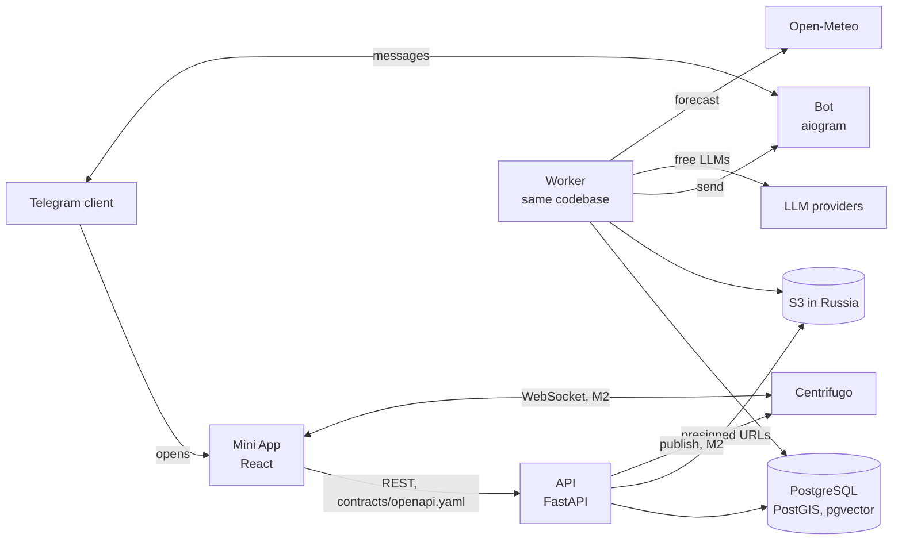

# Ayda: architecture

Stack and module boundaries are decided in ADR 0002 and 0003; the API contract approach in ADR 0004. This file describes how the parts fit and the MVP data model.

## Runtime

Realtime (M2, ADR 0007): each user has one personal Centrifugo channel `personal:#<user id>` that only their connection can subscribe to (`POST /realtime/token` issues a 1-hour connection token). The API saves a change in PostgreSQL, commits, then broadcasts an event to the personal channels of the people who should see it (`ayda.app.realtime`); if Centrifugo is down, a `realtime.publish` job retries with ids only. Centrifugo keeps 1 hour of history per channel for recovery after a dropped connection; REST is the source of truth after that.

API, worker and bot are three entry points of one Python package. The job queue lives in PostgreSQL. Everything that stores personal data (PostgreSQL, S3, backups) runs on servers in Russia.

## Modules and ownership

Each module owns a PostgreSQL schema of the same name and is the only code that reads or writes it. Modules never import each other (import-linter). References across modules are plain ids without foreign keys; integrity across modules is the job of the application layer.

| Module | Schema | Owns |
| --- | --- | --- |
| auth | `auth` | users, profile settings, consents |
| habits | `habits` | user goals and own habits; Steam and screen time integrations later |
| quests | `quests` | quest catalog, check-ins, daily pools and quests, points ledger, streaks; co-op quests (M2) |
| assistant | `assistant` | LLM call metadata (no prompt or answer text) |
| social | `social` | invites, friendships, posts (proofs and routines), media, likes, comments |
| chat | `chat` | conversations, members, messages (M2) |
| events | `events` | city reference for onboarding and weather (M1), event listings (M3) |
| analytics | `analytics` | append-only `events` log |

Use cases that span modules (complete a quest = award points in `quests` + create a post in `social` + log to `analytics`; the ladder = friends from `social` + weekly points from `quests`) live in an application layer above the modules (`ayda/app/`), which may call several modules' public functions. HTTP routers sit on top of the application layer.

## Data model (MVP)

Conventions: primary keys are UUID v7 (`uuid`) unless noted; times are `timestamptz` in UTC; `local_date` is the calendar date in the user's time zone at the moment of the action; enums are PostgreSQL enums or `text` with a check constraint. `→` marks a reference by id; `FK` marks a real foreign key, used only inside one schema.

### auth

**auth.users**

| Column | Type | Notes |
| --- | --- | --- |
| id | uuid PK | |
| telegram_id | bigint unique | |
| first_name | text | from Telegram |
| last_name, username | text null | from Telegram |
| avatar_url | text null | Telegram photo URL |
| city_id | int null | → events.cities |
| timezone | text | IANA, derived from the city; default `Europe/Moscow` |
| theme | text | `graphite` \| `plum`, default `graphite` |
| morning_reminder_at | time null | local time; null = off |
| evening_reminder_at | time null | local time; null = off |
| bot_reachable | bool | false after the user blocks the bot |
| onboarded_at | timestamptz null | |
| created_at | timestamptz | |
| deletion_requested_at | timestamptz null | erase job runs within 30 days |

**auth.consents**: id, user_id FK, version text, accepted_at. One row per accepted version.

No session table: the API issues short-lived signed tokens after the initData check.

### habits

**habits.user_goals**: user_id, goal_code text (catalog in code), created_at; PK (user_id, goal_code). 1-5 per user.

**habits.user_habits**: id, user_id, direction (`more` \| `less`), text varchar(100), created_at, archived_at null.

### quests

**quests.templates** (the catalog; seeded from a versioned file)

| Column | Type | Notes |
| --- | --- | --- |
| id | int PK | stable across catalog versions |
| slug | text unique | |
| title, description | text | Russian |
| category | enum | `sport`, `walk`, `city`, `rest`, `project`, `social`, `home`, `learning` |
| duration_min | smallint | |
| outdoor | bool | |
| weather | jsonb | e.g. `{"no_rain": true, "min_temp_c": -15}` |
| tags | text[] | |
| goal_codes | text[] | goals the quest serves |
| active | bool | |

**quests.checkins**

| Column | Type | Notes |
| --- | --- | --- |
| id | uuid PK | |
| user_id | uuid | → auth.users |
| local_date | date | unique with user_id |
| text | varchar(1000) null | null when empty or purged after 30 days |
| mood | enum | `energetic`, `normal`, `tired` |
| parsed | jsonb | tasks, busy and free slots from the assistant; no free text beyond task titles |
| created_at, updated_at | timestamptz | a new check-in the same day overwrites |

**quests.day_pools**: id, user_id, local_date (unique with user_id), checkin_id FK null, status (`generating` \| `ready` \| `failed`), ranked_by (`llm` \| `code`), provider text null, replacements_used smallint, created_at.

**quests.day_quests** (every quest offered or taken on a day)

| Column | Type | Notes |
| --- | --- | --- |
| id | uuid PK | |
| pool_id | uuid FK | → quests.day_pools |
| user_id | uuid | → auth.users |
| local_date | date | |
| source | enum | `catalog`, `checkin_task`, `custom`, `coop` (joined from a friend's co-op), `event` (M3) |
| template_id | int FK null | for `catalog` |
| event_id, event | bigint null, jsonb null | for `event`: the listing id (no FK across modules) and a snapshot of title, time, venue, address, city, price, link and source |
| title | text | snapshot, so catalog edits don't rewrite history |
| category | enum | |
| duration_min | smallint | |
| why | text null | "why you" line |
| position | smallint | order in the pool |
| state | enum | `offered`, `taken`, `replaced`, `completed`, `expired` |
| replaced_by_id | uuid FK null | the alternative |
| reject_reason | enum null | `no_time`, `dont_want`, `cant` |
| visibility | enum null | `personal`, `routine`, `friends`; set on completion |
| taken_at, completed_at | timestamptz null | |
| expires_at | timestamptz | 04:00 local time the next day |

At most 3 rows per user and day in `taken` or `completed` (checked in a transaction).

**quests.points_ledger** (append-only)

| Column | Type | Notes |
| --- | --- | --- |
| id | bigint identity PK | |
| user_id | uuid | |
| day_quest_id | uuid FK | unique with kind |
| kind | text | `quest` (one award per quest) or `coop_bonus` (one bonus per quest of a finished co-op) |
| local_date | date | |
| week_start | date | Monday of the user's local week, for the ladder |
| points | int | final value |
| breakdown | jsonb | base, visibility and streak multipliers, config version |
| created_at | timestamptz | |

**quests.streaks**: user_id PK, current_days int, best_days int, last_counted_date date null, freeze_week_start date null (the week in which the free freeze was used), updated_at.

M2 adds **quests.coops** (id, owner_id, title, description, category, duration_min, outdoor, expires_at = the end of the owner's day, bonus_awarded_at null, created_at) and **quests.coop_participants** (coop_id FK cascade, user_id, status `owner` \| `invited` \| `accepted` \| `declined`, day_quest_id FK unique null, invited_at, answered_at; PK coop_id + user_id).

Co-op quests (US-18): the owner turns a taken quest of today into a co-op and invites 1-3 friends. Whoever accepts before the owner's day ends gets the same quest in their own day as taken (it counts toward the limit of 3) and joins the co-op chat. Once everyone who joined (at least two people) has completed it, each of them gets a `coop_bonus` ledger row worth 50% of their quest points (`coop_bonus_share` in the scoring config); a late joiner gets theirs when they complete. Completing locks the day pool, then the co-op row, so two last completions at once still award the bonus exactly once. Participants get `coop.updated` over Centrifugo; invitees and those who get the bonus while away get a bot message. Erasing an account deletes the co-ops it started and its places in others.

### assistant

**assistant.llm_calls**: id, purpose (`parse_checkin` \| `rank_pool`), provider, model, latency_ms, ok bool, error_kind text null, created_at. No prompt or answer text, ever.

### social

**social.invites**: code text PK (random, 10+ chars), inviter_id, created_at, expires_at (created_at + 7 days).

**social.friendships**: user_low, user_high (the two user ids ordered, so a pair is stored once), created_at; PK (user_low, user_high). Removing a friend deletes the row.

**social.posts**

| Column | Type | Notes |
| --- | --- | --- |
| id | uuid PK | |
| author_id | uuid | → auth.users |
| day_quest_id | uuid unique | → quests.day_quests |
| kind | enum | `proof` (friends visibility) or `routine` |
| quest_title | text null | null for `routine`: friends see only the category |
| category | enum | |
| caption | varchar(500) null | proofs only |
| local_date | date | |
| created_at | timestamptz | feed order |
| deleted_at | timestamptz null | |

Personal quests never create a post.

**social.media**: id, owner_id, post_id FK null (null until attached), storage_key text, content_type, size_bytes, width, height, status (`pending` \| `processing` \| `ready` \| `failed`), created_at. The worker strips EXIF and makes a resized copy before `ready`.

**social.likes**: post_id FK, user_id, created_at; PK (post_id, user_id).

**social.comments**: id, post_id FK, author_id, text varchar(500), created_at, deleted_at null.

### chat (M2)

**chat.conversations**: id, kind (`dm` \| `coop`), dm_key text unique null (the two user ids ordered, so a pair has one chat), coop_id unique null, created_at, last_message_at null. **chat.members**: conversation_id FK, user_id, last_read_message_id bigint null, joined_at; PK both. **chat.messages**: id bigint identity, conversation_id FK, author_id, client_id uuid null (unique with author_id: retries are saved once), text varchar(2000), created_at, deleted_at null (a deleted message loses its text at once).

Only friends can open a DM; once the friendship is removed the chat stays readable but takes no new messages, and nothing more is published to the former friend. Members get each new message over Centrifugo; the bot sends "Тебе пишет <name>" a minute later, at most once per chat and 10 minutes, and only if the message is still unread. A user can send at most 30 messages a minute.

### events

**events.cities** (M1, reference data loaded from an open dataset): id int PK, name, region_code, region_name, timezone, location geography(Point), population. Used by onboarding (nearest city to a one-time geolocation; the raw coordinates are not stored) and by weather.

**events.listings** (M3, ADR 0008): id, source (`timepad`, `kudago`, `culture`), source_id (unique with source; KudaGo adds the start time, one row per date), title, starts_at, ends_at null, venue null, address null, location geography(Point) null, city_id → events.cities, region_code, is_free, price_min null (rubles), url, category, fetched_at. No personal data. The worker's `events.ingest` job runs once a day after 04:00 Moscow time: it loads the next 3 days for every city that has users plus the largest city of each of their regions, and drops listings that ended more than 2 days ago.

Event quests (US-19): when the pool is built, code picks up to 2 events starting between now + 1 hour and the end of the quest day, in the user's city first, then elsewhere in the region by distance, one per title and not longer than the user's free time; they take the place of catalog quests, so the pool keeps 6 suggestions. Replacing an event quest offers the next event candidate, else a catalog quest.

### analytics

**analytics.events** (append-only; the app role has INSERT and SELECT only)

| Column | Type | Notes |
| --- | --- | --- |
| id | bigint identity PK | |
| occurred_at | timestamptz | indexed with type |
| user_id | uuid null | replaced with a random id on account deletion |
| type | text | `checkin_submitted`, `pool_shown`, `quest_taken`, `quest_rejected`, `quest_completed`, `proof_posted`, `reaction_added`, `reminder_sent`, `reminder_opened`, ... |
| schema_version | smallint | per type |
| payload | jsonb | ids, enums and numbers only; a denylist test bans text, coordinates, initData and URLs |

Partitioning by month can be added when the table grows; not needed for the MVP.

## Personal data map

| Data | Where | Retention |
| --- | --- | --- |
| Telegram name, avatar URL | auth.users | until account deletion |
| City and time zone | auth.users | until account deletion |
| Raw geolocation | nowhere | used once to find the nearest city |
| Own habits | habits.user_habits | until deleted by the user or account deletion |
| Check-in text | quests.checkins.text | 30 days, then set to null |
| Photos | S3 in Russia | until the proof or account is deleted; EXIF removed |
| Comments, messages | social.comments, chat.messages | until deleted or account deletion |
| Behavior events | analytics.events | kept, anonymized on account deletion |

### Where the data lives (152-FZ)

Every store with personal data runs on servers in Russia: PostgreSQL on the Russian VPS, photos in an S3-compatible object storage of a Russian provider (bucket private, access only through presigned URLs valid 15 minutes for upload and 1 hour for reading), and backups of both in the same jurisdiction. Logs stay on the VPS and pass through a redaction filter (`ayda.core.logging`) that removes initData, tokens, presigned URL signatures, coordinates and free-text fields. The only cross-border transfer is the check-in text and an anonymized profile sent to the LLM providers of ADR 0005; the consent says so.

### Account deletion and retention

`DELETE /me` marks the account at once (all tokens stop working) and queues `account.erase`, which the worker runs right away, well within the 30 days the law allows: profile, consents, goals, habits, check-ins, day quests, points, streaks, posts (with the likes and comments on them), the user's own likes, comments, invites, friendships and photos are deleted; photo files are removed by a retried `media.delete_files` job; queued messages to the user are dropped; `analytics.events` rows get one random id instead of the user's, including ids of the user inside other users' event payloads. A periodic job sets check-in texts older than 30 days to null.

### Backups and error tracking

The worker queues `db.backup` once a day after 03:30 Moscow time (dedupe key per date, retried on failure): `pg_dump --format=custom` of the whole database, uploaded to the private backup bucket (`BACKUP_BUCKET`, same Russian S3 provider) as `db/<UTC time>.dump`. Dumps older than 14 days (`BACKUP_KEEP_DAYS`) are deleted after each upload, so an erased account leaves the backups within 14 days. After restoring a dump, re-run `account.erase` for accounts deleted since that dump was taken. `python -m ayda.core.backup create|list|restore` does the same by hand; the restore goes into an empty database and is checked before anything is switched to it (tested in `tests/test_backup.py`, rehearsed monthly on the VPS).

Errors go to a self-hosted GlitchTip through the Sentry SDK when `SENTRY_DSN` is set. Events carry no user, request body, headers, cookies, query strings or local variables, and their texts pass through the same redaction as the logs (`ayda.core.errors.scrub`). A job that gives up after its last attempt is logged at error level and so shows up there.
