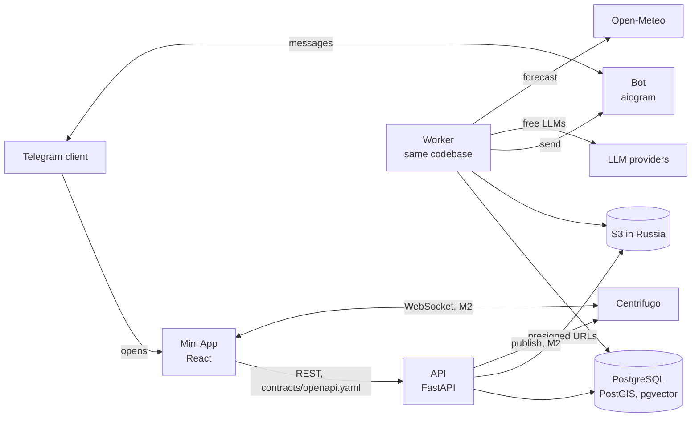

# Ayda: архитектура

[English](../architecture.md) · Русский

Стек и границы модулей закреплены в ADR 0002 и 0003, подход к контракту API - в ADR 0004. Здесь описано, как части связаны между собой, и модель данных MVP.

## Среда выполнения

Realtime (M2, ADR 0007): у каждого пользователя один личный канал Centrifugo `personal:#<user id>`, на который может подписаться только его соединение (`POST /realtime/token` выдаёт токен соединения на 1 час). API сохраняет изменение в PostgreSQL, делает коммит, затем рассылает событие в личные каналы тех, кто должен его увидеть (`ayda.app.realtime`); если Centrifugo недоступен, задача `realtime.publish` повторяет отправку только с id. Centrifugo хранит 1 час истории на канал для восстановления после обрыва соединения; дальше источник истины - REST.

API, воркер и бот - три точки входа одного Python-пакета. Очередь задач живёт в PostgreSQL. Всё, что хранит персональные данные (PostgreSQL, S3, бэкапы), работает на серверах в России.

## Модули и владение данными

Каждый модуль владеет одноимённой схемой PostgreSQL и единственный читает и пишет её. Модули никогда не импортируют друг друга (import-linter). Ссылки между модулями - просто id без внешних ключей; целостность между модулями обеспечивает прикладной слой.

| Модуль | Схема | Владеет |
| --- | --- | --- |
| auth | `auth` | пользователи, настройки профиля, согласия |
| habits | `habits` | цели пользователя и его собственные привычки; интеграции со Steam и экранным временем позже |
| quests | `quests` | каталог квестов, чек-ины, дневные пулы и квесты, журнал очков, серии; кооп-квесты (M2) |
| assistant | `assistant` | метаданные вызовов LLM (без текста промптов и ответов) |
| social | `social` | приглашения, дружба, посты (пруфы и рутины), медиа, лайки, комментарии |
| chat | `chat` | беседы, участники, сообщения (M2) |
| events | `events` | справочник городов для онбординга и погоды (M1), афиша событий (M3) |
| analytics | `analytics` | append-only журнал `events` |

Сценарии, затрагивающие несколько модулей (выполнить квест = начислить очки в `quests` + создать пост в `social` + записать в `analytics`; лестница = друзья из `social` + недельные очки из `quests`), живут в прикладном слое над модулями (`ayda/app/`), который может вызывать публичные функции нескольких модулей. HTTP-роутеры располагаются поверх прикладного слоя.

## Модель данных (MVP)

Соглашения: первичные ключи - UUID v7 (`uuid`), если не указано иное; время - `timestamptz` в UTC; `local_date` - календарная дата в часовом поясе пользователя на момент действия; перечисления - enum PostgreSQL или `text` с check-ограничением. `→` обозначает ссылку по id; `FK` - настоящий внешний ключ, используется только внутри одной схемы.

### auth

**auth.users**

| Колонка | Тип | Примечания |
| --- | --- | --- |
| id | uuid PK | |
| telegram_id | bigint unique null | null у пользователей, входивших только по email (M4) |
| first_name | text | из Telegram; пусто у нового email-пользователя, пока он не задаст имя в онбординге |
| last_name, username | text null | из Telegram |
| avatar_url | text null | URL фото в Telegram |
| city_id | int null | → events.cities |
| timezone | text | IANA, определяется по городу; по умолчанию `Europe/Moscow` |
| theme | text | `graphite` \| `plum`, по умолчанию `graphite` |
| morning_reminder_at | time null | местное время; null = выключено |
| evening_reminder_at | time null | местное время; null = выключено |
| bot_reachable | bool | false после того, как пользователь заблокировал бота |
| onboarded_at | timestamptz null | |
| created_at | timestamptz | |
| deletion_requested_at | timestamptz null | задача удаления выполняется в течение 30 дней |

**auth.consents**: id, user_id FK, version text, accepted_at. Одна строка на каждую принятую версию.

**auth.identities** (M4, ADR 0009): id, user_id FK cascade, provider `telegram` \| `email`, subject (id пользователя Telegram или нормализованный email), created_at; provider + subject уникальны. Вход через Telegram добавляет свою identity; вход по email находит или создаёт пользователя по ней.

**auth.email_codes**: email_key bytea PK (HMAC от email), code_hash, attempts, expires_at (10 минут), created_at. Один действующий код на email; 5 неверных попыток сжигают его. **auth.email_sends**: email_key, client_key (HMAC от адреса клиента), sent_at; лимиты (1 в минуту и 5 в час на email, 20 в час на клиента), строки старше суток удаляются. Адрес не хранится, пока его владелец не войдёт.

**auth.telegram_login_requests**: id, code_hash unique (SHA-256 от кода в `t.me/<bot>?start=login_<code>`), secret_hash (SHA-256 от секрета опроса приложения), client_key (HMAC от адреса клиента; 20 запросов в час), link_user_id FK cascade null (задаётся, когда вошедший пользователь привязывает Telegram), status `pending` \| `approved` \| `used`, telegram_id, first_name, last_name, username (заполняются, когда пользователь подтверждает вход в боте), expires_at (5 минут), approved_at, created_at; строки старше суток удаляются. Привязка держит `auth.users.telegram_id` в соответствии с identity `telegram`; аккаунт Telegram или email, уже принадлежащий другому пользователю, не привязывается, а последний способ входа удалить нельзя.

**auth.devices** (M4): id, user_id FK cascade, platform `android` \| `ios`, token (FCM) unique, created_at, last_seen_at. Токен переходит к тому, кто зарегистрировал его последним; токены, которые FCM помечает как незарегистрированные, удаляются. `auth.users.notification_channel` (`auto` \| `push` \| `telegram`, по умолчанию `auto`) выбирает, куда идут уведомления: `auto` отправляет пуш на телефоны пользователя, если они есть, а иначе использует бота. У пуша общий текст для каждого вида, а в данных только вид и id; имена и тексты сообщений никогда не проходят через Google.

**auth.refresh_tokens**: id, user_id FK cascade, family_id, token_hash (SHA-256) unique, expires_at (60 дней), used_at, revoked_at, created_at. Только для нативных сессий; каждое обновление помечает токен использованным и выдаёт следующий в семействе; повторно предъявленный использованный токен отзывает всё семейство. Выход из аккаунта отзывает семейство, удаление аккаунта отзывает все токены пользователя.

API выдаёт короткоживущие подписанные access-токены (12 часов) после проверки initData или кода из email; Mini App входит заново через initData, нативные приложения используют refresh-токены.

### habits

**habits.user_goals**: user_id, goal_code text (каталог в коде), created_at; PK (user_id, goal_code). 1-5 на пользователя.

**habits.user_habits**: id, user_id, direction (`more` \| `less`), text varchar(100), created_at, archived_at null.

### quests

**quests.templates** (каталог; заполняется из версионируемого файла)

| Колонка | Тип | Примечания |
| --- | --- | --- |
| id | int PK | стабилен между версиями каталога |
| slug | text unique | |
| title, description | text | на русском |
| category | enum | `sport`, `walk`, `city`, `rest`, `project`, `social`, `home`, `learning` |
| duration_min | smallint | |
| outdoor | bool | |
| weather | jsonb | например, `{"no_rain": true, "min_temp_c": -15}` |
| tags | text[] | |
| goal_codes | text[] | цели, которым служит квест |
| active | bool | |

**quests.checkins**

| Колонка | Тип | Примечания |
| --- | --- | --- |
| id | uuid PK | |
| user_id | uuid | → auth.users |
| local_date | date | уникальна вместе с user_id |
| text | varchar(1000) null | null, если пусто или очищено через 30 дней |
| mood | enum | `energetic`, `normal`, `tired` |
| parsed | jsonb | задачи, занятые и свободные слоты от ассистента; никакого свободного текста, кроме названий задач |
| created_at, updated_at | timestamptz | новый чек-ин в тот же день перезаписывает старый |

**quests.day_pools**: id, user_id, local_date (уникальна вместе с user_id), checkin_id FK null, status (`generating` \| `ready` \| `failed`), ranked_by (`llm` \| `code`), provider text null, replacements_used smallint, created_at.

**quests.day_quests** (каждый квест, предложенный или взятый за день)

| Колонка | Тип | Примечания |
| --- | --- | --- |
| id | uuid PK | |
| pool_id | uuid FK | → quests.day_pools |
| user_id | uuid | → auth.users |
| local_date | date | |
| source | enum | `catalog`, `checkin_task`, `custom`, `coop` (присоединение к коопу друга), `event` (M3) |
| template_id | int FK null | для `catalog` |
| event_id, event | bigint null, jsonb null | для `event`: id события в афише (без FK между модулями) и снимок названия, времени, площадки, адреса, города, цены, ссылки и источника |
| title | text | снимок, чтобы правки каталога не переписывали историю |
| category | enum | |
| duration_min | smallint | |
| why | text null | строка «почему ты» |
| position | smallint | порядок в пуле |
| state | enum | `offered`, `taken`, `replaced`, `completed`, `expired` |
| replaced_by_id | uuid FK null | альтернатива |
| reject_reason | enum null | `no_time`, `dont_want`, `cant` |
| visibility | enum null | `personal`, `routine`, `friends`; задаётся при выполнении |
| taken_at, completed_at | timestamptz null | |
| expires_at | timestamptz | 04:00 по местному времени следующего дня |

Не больше 3 строк на пользователя в день в состоянии `taken` или `completed` (проверяется в транзакции).

**quests.points_ledger** (append-only)

| Колонка | Тип | Примечания |
| --- | --- | --- |
| id | bigint identity PK | |
| user_id | uuid | |
| day_quest_id | uuid FK | уникален вместе с kind |
| kind | text | `quest` (одно начисление на квест) или `coop_bonus` (один бонус на квест завершённого коопа) |
| local_date | date | |
| week_start | date | понедельник локальной недели пользователя, для лестницы |
| points | int | итоговое значение |
| breakdown | jsonb | база, множители видимости и серии, версия конфига |
| created_at | timestamptz | |

**quests.streaks**: user_id PK, current_days int, best_days int, last_counted_date date null, freeze_week_start date null (неделя, в которую использована бесплатная заморозка), updated_at.

M2 добавляет **quests.coops** (id, owner_id, title, description, category, duration_min, outdoor, expires_at = конец дня владельца, bonus_awarded_at null, created_at) и **quests.coop_participants** (coop_id FK cascade, user_id, status `owner` \| `invited` \| `accepted` \| `declined`, day_quest_id FK unique null, invited_at, answered_at; PK coop_id + user_id).

Кооп-квесты (US-18): владелец превращает взятый сегодня квест в кооп и приглашает 1-3 друзей. Кто принял приглашение до конца дня владельца, получает тот же квест в свой день как взятый (он учитывается в лимите 3) и попадает в чат коопа. Когда все присоединившиеся (минимум двое) его выполнили, каждый получает строку `coop_bonus` в журнале на 50% своих очков за квест (`coop_bonus_share` в конфиге начисления очков); опоздавший получает свою, когда выполнит. При выполнении сначала блокируется дневной пул, затем строка коопа, так что даже два одновременных последних выполнения начисляют бонус ровно один раз. Участники получают `coop.updated` через Centrifugo; приглашённые и те, кто получил бонус, пока были не в приложении, получают сообщение от бота. Удаление аккаунта удаляет созданные им коопы и его места в чужих.

M5 (ADR 0010) добавляет коопы из частей: **quests.coops** получает `kind` (`same` \| `parts`), `place` jsonb null и `starts_at` null; **quests.coop_parts** (id, coop_id FK cascade, position, title, category, duration_min, place null, starts_at null, assignee_id, opens_after_part_id FK null, day_quest_id FK unique null, state `locked` \| `open` \| `done`, completed_at null), **quests.coop_part_items** (id, part_id FK cascade, position, text varchar(120), done, done_at null) и **quests.coop_handoffs** (part_id PK FK cascade, from_user_id, to_user_id, created_at; строка есть, только пока предложение ждёт ответа). Квест части создаётся, когда она открывается, и не учитывается в лимите 3; выполнение последней части даёт каждому участнику один `coop_bonus`. Изменения доходят до участников через существующий `coop.updated`.

### assistant

**assistant.llm_calls**: id, purpose (`parse_checkin` \| `rank_pool`), provider, model, latency_ms, ok bool, error_kind text null, created_at. Никакого текста промптов и ответов, никогда.

### social

**social.invites**: code text PK (случайный, 10+ символов), inviter_id, created_at, expires_at (created_at + 7 дней).

**social.friendships**: user_low, user_high (два id пользователей по порядку, чтобы пара хранилась один раз), created_at; PK (user_low, user_high). Удаление друга удаляет строку.

**social.posts**

| Колонка | Тип | Примечания |
| --- | --- | --- |
| id | uuid PK | |
| author_id | uuid | → auth.users |
| day_quest_id | uuid unique | → quests.day_quests |
| kind | enum | `proof` (видимость для друзей) или `routine` |
| quest_title | text null | null для `routine`: друзья видят только категорию |
| category | enum | |
| caption | varchar(500) null | только для пруфов |
| local_date | date | |
| created_at | timestamptz | порядок ленты |
| deleted_at | timestamptz null | |

Личные квесты никогда не создают пост.

**social.media**: id, owner_id, post_id FK null (null, пока не прикреплено), storage_key text, content_type, size_bytes, width, height, status (`pending` \| `processing` \| `ready` \| `failed`), created_at. Перед `ready` воркер удаляет EXIF и делает уменьшенную копию.

**social.likes**: post_id FK, user_id, created_at; PK (post_id, user_id).

**social.comments**: id, post_id FK, author_id, text varchar(500), created_at, deleted_at null.

### chat (M2)

**chat.conversations**: id, kind (`dm` \| `coop`), dm_key text unique null (два id пользователей по порядку, чтобы у пары был один чат), coop_id unique null, created_at, last_message_at null. **chat.members**: conversation_id FK, user_id, last_read_message_id bigint null, joined_at; PK по обоим. **chat.messages**: id bigint identity, conversation_id FK, author_id, client_id uuid null (уникален вместе с author_id: повторные отправки сохраняются один раз), text varchar(2000), created_at, deleted_at null (удалённое сообщение сразу теряет текст).

Открыть личный чат могут только друзья; после удаления дружбы чат остаётся доступным для чтения, но новые сообщения не принимает, и бывшему другу больше ничего не публикуется. Участники получают каждое новое сообщение через Centrifugo; бот отправляет «Тебе пишет <name>» через минуту, не чаще раза в 10 минут на чат и только если сообщение всё ещё не прочитано. Пользователь может отправить не больше 30 сообщений в минуту.

### events

**events.cities** (M1, справочные данные из открытого датасета): id int PK, name, region_code, region_name, timezone, location geography(Point), population. Используется онбордингом (ближайший город по разовой геолокации; сырые координаты не хранятся) и погодой.

**events.listings** (M3, ADR 0008): id, source (`timepad`, `kudago`, `culture`), source_id (уникален вместе с source; KudaGo добавляет время начала, одна строка на дату), title, starts_at, ends_at null, venue null, address null, location geography(Point) null, city_id → events.cities, region_code, is_free, price_min null (рубли), url, category, fetched_at. Никаких персональных данных. Задача воркера `events.ingest` запускается раз в день после 04:00 по Москве: она загружает ближайшие 3 дня для каждого города, где есть пользователи, плюс крупнейшего города каждого из их регионов, и удаляет события, закончившиеся больше 2 дней назад.

Квесты-события (US-19): при сборке пула код выбирает до 2 событий, начинающихся между «сейчас + 1 час» и концом дня квестов, сначала в городе пользователя, затем в остальном регионе по расстоянию, по одному на название и не дольше свободного времени пользователя; они занимают место квестов из каталога, так что в пуле остаётся 6 предложений. Замена квеста-события предлагает следующего кандидата-событие, иначе квест из каталога.

### analytics

**analytics.events** (append-only; у роли приложения только INSERT и SELECT)

| Колонка | Тип | Примечания |
| --- | --- | --- |
| id | bigint identity PK | |
| occurred_at | timestamptz | индекс вместе с type |
| user_id | uuid null | при удалении аккаунта заменяется случайным id |
| type | text | `checkin_submitted`, `pool_shown`, `quest_taken`, `quest_rejected`, `quest_completed`, `proof_posted`, `reaction_added`, `reminder_sent`, `reminder_opened`, `signed_in` (нативный вход, в payload provider и new), ... |
| schema_version | smallint | для каждого type своя |
| payload | jsonb | только id, enum и числа; тест с denylist запрещает текст, координаты, initData и URL |

Партиционирование по месяцам можно добавить, когда таблица вырастет; для MVP не нужно.

## Карта персональных данных

| Данные | Где | Срок хранения |
| --- | --- | --- |
| Имя в Telegram, URL аватара | auth.users | до удаления аккаунта |
| Город и часовой пояс | auth.users | до удаления аккаунта |
| Сырая геолокация | нигде | используется один раз для поиска ближайшего города |
| Собственные привычки | habits.user_habits | пока пользователь не удалит или до удаления аккаунта |
| Текст чек-ина | quests.checkins.text | 30 дней, затем обнуляется |
| Фото | S3 в России | до удаления пруфа или аккаунта; EXIF удалён |
| Комментарии, сообщения | social.comments, chat.messages | до удаления или удаления аккаунта |
| Поведенческие события | analytics.events | хранятся, при удалении аккаунта обезличиваются |

### Где лежат данные (152-ФЗ)

Все хранилища с персональными данными работают на серверах в России: PostgreSQL на российском VPS, фото в S3-совместимом объектном хранилище российского провайдера (бакет приватный, доступ только через presigned URL, действующие 15 минут на загрузку и 1 час на чтение), бэкапы того и другого в той же юрисдикции. Логи остаются на VPS и проходят через фильтр редактирования (`ayda.core.logging`), который удаляет initData, токены, подписи presigned URL, координаты и поля со свободным текстом. Единственная трансграничная передача - текст чек-ина и обезличенный профиль, отправляемые LLM-провайдерам из ADR 0005; об этом сказано в согласии.

### Удаление аккаунта и сроки хранения

`DELETE /me` сразу помечает аккаунт (все токены перестают работать) и ставит в очередь `account.erase`, которую воркер выполняет немедленно, с большим запасом до разрешённых законом 30 дней: удаляются профиль, согласия, цели, привычки, чек-ины, дневные квесты, очки, серии, посты (вместе с лайками и комментариями к ним), собственные лайки, комментарии, приглашения, дружба и фото пользователя; файлы фото удаляет задача `media.delete_files` с повторами; сообщения пользователю в очереди отбрасываются; строки `analytics.events` получают один случайный id вместо id пользователя, в том числе id пользователя внутри payload событий других пользователей. Периодическая задача обнуляет тексты чек-инов старше 30 дней.

### Бэкапы и отслеживание ошибок

Воркер ставит в очередь `db.backup` раз в день после 03:30 по Москве (ключ дедупликации на дату, повтор при сбое): `pg_dump --format=custom` всей базы, загружается в приватный бакет для бэкапов (`BACKUP_BUCKET`, тот же российский S3-провайдер) как `db/<UTC time>.dump`. Дампы старше 14 дней (`BACKUP_KEEP_DAYS`) удаляются после каждой загрузки, так что удалённый аккаунт исчезает из бэкапов в течение 14 дней. После восстановления дампа нужно заново запустить `account.erase` для аккаунтов, удалённых после снятия этого дампа. `python -m ayda.core.backup create|list|restore` делает то же вручную; восстановление идёт в пустую базу и проверяется до того, как на неё что-либо переключат (тест в `tests/test_backup.py`, ежемесячная репетиция на VPS).

Ошибки уходят в self-hosted GlitchTip через Sentry SDK, если задан `SENTRY_DSN`. События не содержат пользователя, тела запроса, заголовков, cookies, query-строк и локальных переменных, а их тексты проходят то же редактирование, что и логи (`ayda.core.errors.scrub`). Задача, сдавшаяся после последней попытки, логируется на уровне error и поэтому попадает туда же.
